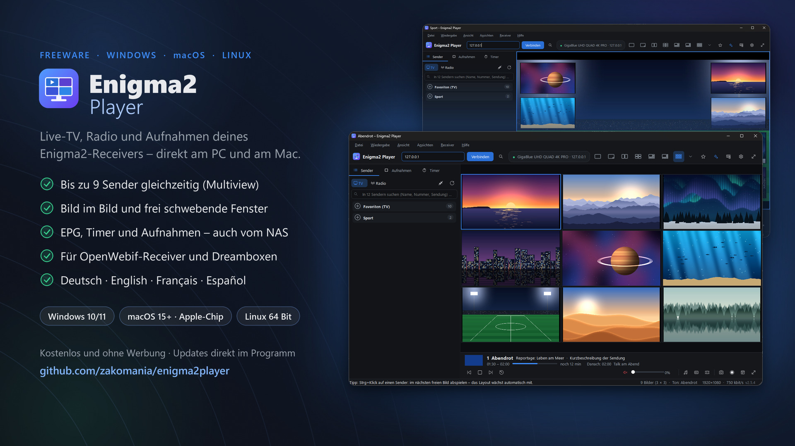
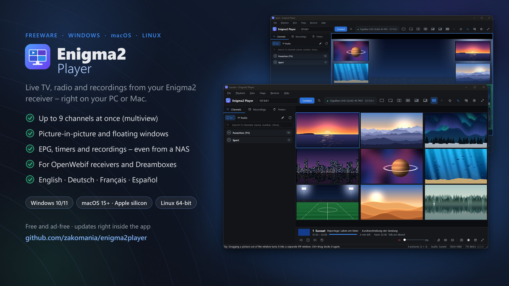

<div align="center">

# Enigma2 Player

**Live-TV, Multiview und Aufnahmen deines Enigma2-Receivers am Computer – für Windows, macOS und Linux**

[](https://github.com/zakomania/enigma2player/releases/latest)
[](#windows)
[](#macos)
[](#linux)
[](#lizenz-und-marken)

**Deutsch** · [English](#english) · [Français](#français) · [Español](#español)

[](https://github.com/zakomania/enigma2player/releases/latest)

</div>

Enigma2 Player zeigt Live-TV, Radio und Aufnahmen von Enigma2-Receivern (VU+, GigaBlue, Zgemma, Octagon … mit
OpenWebif, Dreamboxen auch mit DreamOS) direkt auf dem PC oder Mac – auf Wunsch bis zu neun Sender gleichzeitig, als
Bild im Bild oder in frei schwebenden Fenstern.

## Download

**Aktuelle Version: 2.5.12** · [Neuerungen und Prüfsummen](https://github.com/zakomania/enigma2player/releases/latest)

| System | Datei | Hinweis |
|---|---|---|
| **Windows** 10 / 11 (64 Bit) | [Enigma2Player-Setup.exe](https://github.com/zakomania/enigma2player/releases/latest/download/Enigma2Player-Setup.exe) | Installer, normal oder portabel – VLC ist enthalten |
| **macOS** 15 Sequoia oder neuer, Mac mit Apple-Chip | [Enigma2Player-macOS.dmg](https://github.com/zakomania/enigma2player/releases/latest/download/Enigma2Player-macOS.dmg) | In „Programme“ ziehen – von Apple geprüft (notarisiert), VLC ist enthalten |
| **Linux** x86_64 | [Enigma2Player-x86_64.AppImage](https://github.com/zakomania/enigma2player/releases/latest/download/Enigma2Player-x86_64.AppImage) | Eine Datei, keine Installation – VLC aus der Paketverwaltung |

Die Links bleiben immer gleich und liefern automatisch die neueste Version.

### Windows

1. `Enigma2Player-Setup.exe` herunterladen und starten.
2. Installationsart wählen: **normal** (für dieses Benutzerkonto, ohne Administratorrechte) oder **portabel**
   (Programm, Einstellungen und Senderlogos in einem Ordner, z. B. auf einem USB-Stick, ohne Einträge in Windows).
3. Ist das Programm schon installiert, aktualisiert der Installer es – Einstellungen, Ansichten und Sitzung bleiben.

> [!NOTE]
> Zeigt Windows beim ersten Start „Der Computer wurde durch Windows geschützt“, auf **Weitere Informationen** →
> **Trotzdem ausführen** klicken. Diese Meldung erscheint bei neuen Programmen, bis Windows sie kennt.

### macOS

Läuft auf jedem **Mac mit Apple-Chip** (M1 und neuer) ab **macOS 15 Sequoia**. Das Programm ist mit einer Developer ID
signiert und von Apple geprüft (notarisiert) – macOS öffnet es ohne Warnung. VLC muss nicht installiert sein.

1. `Enigma2Player-macOS.dmg` herunterladen und öffnen.
2. **Enigma2 Player** auf den Ordner **Applications** ziehen und aus „Programme“ starten.
3. Beim ersten Verbinden fragt macOS, ob Enigma2 Player **Geräte im lokalen Netzwerk finden** darf → **Erlauben**.
   Ohne diese Freigabe erreicht das Programm den Receiver nicht; nachträglich unter Systemeinstellungen → Datenschutz
   & Sicherheit → Lokales Netzwerk.

Die Menüleiste steht wie bei jedem Mac-Programm oben am Bildschirm, die Tastenkürzel nutzen ⌘ statt Strg. Einstellungen
liegen in `~/Library/Application Support/Enigma2Player`. Updates lädt das Programm selbst (Hilfe → Nach Updates
suchen) und tauscht sich aus, sobald die Signatur der neuen Version geprüft ist. Entfernen: Enigma2 Player in den
Papierkorb ziehen.

> [!NOTE]
> Macs mit Intel-Prozessor werden nicht unterstützt.

### Linux

Läuft auf Ubuntu 22.04, Linux Mint 21, Debian 12, Fedora und neueren Systemen (X11 oder Wayland). Jede Version wird
vor der Veröffentlichung auf Ubuntu 22.04, 24.04 und 26.04, Debian 12 und 13, Fedora, openSUSE Tumbleweed und Arch
Linux geprüft.

> [!IMPORTANT]
> **VLC muss über die Paketverwaltung installiert sein** – VLC als Snap oder Flatpak genügt nicht, weil das Programm
> die Bibliothek libVLC des Systems verwendet.

```bash
sudo apt install vlc        # Ubuntu, Linux Mint, Debian
sudo pacman -S vlc          # Arch Linux, Manjaro
```

**Fedora** liefert VLC ohne die Codecs vieler Fernsehsender. Deshalb VLC mit dem ffmpeg-Modul installieren und für
alle Formate (z. B. HEVC für UHD-Sender) das vollständige ffmpeg aus [RPM Fusion](https://rpmfusion.org) nutzen:

```bash
sudo dnf install vlc vlc-plugin-ffmpeg
sudo dnf install https://mirrors.rpmfusion.org/free/fedora/rpmfusion-free-release-$(rpm -E %fedora).noarch.rpm
sudo dnf swap ffmpeg-free ffmpeg --allowerasing
```

**openSUSE:** VLC und das Paket `vlc-codecs` aus dem Packman-Repository installieren.

1. `Enigma2Player-x86_64.AppImage` herunterladen.
2. Ausführbar machen: Rechtsklick → Eigenschaften → „Als Programm ausführen“ – oder im Terminal
   `chmod +x Enigma2Player-x86_64.AppImage`
3. Mit Doppelklick starten oder `./Enigma2Player-x86_64.AppImage` – keine Installation, keine Root-Rechte.

Einstellungen liegen in `~/.config/Enigma2Player`; für die portable Nutzung eine leere Datei `portable.ini` neben das
AppImage legen. Meldet das AppImage, dass FUSE fehlt: `sudo apt install fuse3` – oder einmalig mit
`--appimage-extract-and-run` starten.

## Funktionen

- **Multiview** mit 2, 3, 4, 6, 8 oder 9 Bildern, **Bild im Bild** mit 1 bis 8 kleinen Bildern über dem Hauptbild
- **Bild-im-Bild-Fenster**: Bilder aus dem Fenster ziehen, frei auf dem Bildschirm verteilen (immer im Vordergrund)
  und wieder andocken
- **Ton aus genau einem Bild**, per Klick umschaltbar
- **Infoleiste wie am Receiver**: Beginn und Ende mit Fortschrittsbalken, Restzeit und nächste Sendung im Bild – auch
  im Vollbild
- **Drag & Drop**: Sender und Aufnahmen auf ein Bild ziehen, Bilder tauschen
- **Ansichten**: Anordnung, Sender und Fenster unter einem Namen speichern und per Tastendruck laden
- **Smart-Suche** im Programm aller Sender, z. B. „fußball jetzt“ oder „krimi heute abend“; **★ Meistgesehen** lernt
  deine Lieblingssender
- **Senderliste** mit aufklappbaren Bouquets und IPTV-Gruppen, Picons, „Jetzt läuft“ und Programmnummern wie am
  Receiver – links oder rechts
- **Sender des Receivers**: Der Sender, der gerade am Fernseher läuft, ist in der Senderliste markiert und mit einem
  Klick im Player – ohne zusätzlichen Tuner
- **Aufnahmen** vom Receiver mit Coverbildern, Weiterschauen und Zeitleiste; **EPG und Timer** – laufende Aufnahmen
  und Timer gekennzeichnet, Timer bearbeiten, laufende Aufnahmen verlängern
- **Stream oder Datei öffnen** (Strg+O, am Mac ⌘O): Stream-Links oder Video- und Musikdateien vom Computer oder NAS
  abspielen
- **IPTV-Listen vom PC** (Strg+L, am Mac ⌘L): eigene Listen (M3U, M3U8, PLS, XSPF …) im Reiter „IPTV“, zusätzlich
  zum Receiver – im Multiview gemischt mit Sendern der Box und Aufnahmen
- **Einschlaf-Timer**: Wiedergabe nach 15 bis 90 Minuten oder am Ende der Sendung beenden – der Ton wird zuletzt
  langsam leiser
- Virtuelle Fernbedienung, lokale Mitschnitte und Bildschirmfotos
- **Receiver-Suche** im Netzwerk, Anmeldung mit sicher gespeichertem Passwort
- **Updates im Programm** (Hilfe → Nach Updates suchen) · Deutsch, Englisch, Französisch und Spanisch

## Systemvoraussetzungen

| | Windows | macOS | Linux |
|---|---|---|---|
| Betriebssystem | Windows 10 oder 11, 64 Bit | macOS 15 Sequoia oder neuer, Mac mit Apple-Chip (M1 und neuer) | Ubuntu 22.04, Linux Mint 21, Debian 12, Fedora und neuer, x86_64 |
| Installation | Installer, normal oder portabel, ohne Administratorrechte | Abbild (.dmg), in „Programme“ ziehen – notarisiert | AppImage, ohne Installation und ohne Root-Rechte |
| Videowiedergabe | VLC ist enthalten | VLC ist enthalten | VLC aus der Paketverwaltung des Systems |
| Einstellungen | `%APPDATA%\Enigma2Player` | `~/Library/Application Support/Enigma2Player` | `~/.config/Enigma2Player` |
| Receiver | Enigma2 mit OpenWebif oder Dreambox-Webinterface (DreamOS) im selben Netzwerk | wie Windows | wie Windows |

Wie viele verschiedene Sender gleichzeitig laufen, hängt von den freien Tunern des Receivers ab. Sender vom selben
Transponder brauchen keinen zusätzlichen Tuner; ein Antennen-Symbol in der Senderliste zeigt sie an.

## Sicherheit und Datenschutz

- **Keine Telemetrie, kein Konto, keine Werbung.** Verbindungen gibt es nur zu deinem Receiver (bei der Suche zu den
  Geräten im Heimnetz), zu Streams, die du selbst öffnest, und – einmal täglich, abschaltbar – zur Update-Prüfung.
- **Passwörter** sind unter Windows verschlüsselt (DPAPI), unter macOS und Linux in einer Datei gespeichert, die nur
  dein Benutzerkonto lesen kann, und erscheinen nie im Protokoll.
- **Geprüfte Updates**: Installer, Abbild bzw. AppImage müssen vollständig sein und zur veröffentlichten
  SHA-256-Prüfsumme passen, sonst wird der Download verworfen; am Mac muss zusätzlich die Signatur der neuen Version
  gültig sein und vom selben Entwickler stammen. Die Prüfsummen stehen bei jedem
  [Release](https://github.com/zakomania/enigma2player/releases/latest).
- **macOS**: signiert mit Developer ID, von Apple notarisiert, „Hardened Runtime“ ohne Sonderberechtigungen, keine
  Sandbox-Ausnahmen – Zugriff aufs Heimnetz und auf geschützte Ordner nur nach deiner Freigabe.
- **Sauber entfernbar**: Die Deinstallation fragt, ob auch Einstellungen, Protokoll und Senderlogos gelöscht werden
  sollen; die portable Version und das AppImage hinterlassen nichts außerhalb ihres Ordners bzw. der Einstellungen.

## Hilfe und Kontakt

Fragen, Fehlerberichte und Ideen gern per E-Mail an **zakomania@gmail.com**. Bei Fehlern hilft die Protokolldatei:
Windows `%APPDATA%\Enigma2Player\enigma2player.log`, macOS
`~/Library/Application Support/Enigma2Player/enigma2player.log`, Linux `~/.config/Enigma2Player/enigma2player.log`.

## Unterstützen

Enigma2 Player ist kostenlos. Wenn er dir gefällt, freue ich mich über eine freiwillige Spende:
**[paypal.me/zakelm](https://paypal.me/zakelm)** – auch im Programm unter Hilfe → Über → Spenden.

## Lizenz und Marken

© 2026 Zakomania. Alle Rechte vorbehalten. Enigma2 Player ist Freeware: kostenlos nutzbar, Weitergabe nur unverändert
und kostenlos (Nutzungsbedingungen im Installer und im Programm unter Hilfe → Über → Lizenzen). Verwendete
Open-Source-Bestandteile und ihre Lizenzen sind dort ebenfalls aufgeführt.

„Enigma2“, „Dreambox“, „VU+“, „Apple“, „Mac“, „macOS“ und andere Namen sind Marken ihrer jeweiligen Inhaber. Das
Programm nutzt die Webschnittstellen der Receiver (OpenWebif bzw. Dreambox-Webinterface).

---

## English

**Live TV, multiview and recordings from your Enigma2 receiver on your computer – for Windows, macOS and Linux.**

[](https://github.com/zakomania/enigma2player/releases/latest)

Enigma2 Player plays live TV, radio and recordings from Enigma2 receivers (VU+, GigaBlue, Zgemma, Octagon … with
OpenWebif, Dreamboxes including DreamOS) right on your PC or Mac – up to nine channels at once if you like, as
picture-in-picture or in floating windows.

### Download

**Current version: 2.5.12** · [What's new and checksums](https://github.com/zakomania/enigma2player/releases/latest)

| System | File | Note |
|---|---|---|
| **Windows** 10 / 11 (64-bit) | [Enigma2Player-Setup.exe](https://github.com/zakomania/enigma2player/releases/latest/download/Enigma2Player-Setup.exe) | Installer, standard or portable – VLC included |
| **macOS** 15 Sequoia or later, Mac with Apple silicon | [Enigma2Player-macOS.dmg](https://github.com/zakomania/enigma2player/releases/latest/download/Enigma2Player-macOS.dmg) | Drag to Applications – notarized by Apple, VLC included |
| **Linux** x86_64 | [Enigma2Player-x86_64.AppImage](https://github.com/zakomania/enigma2player/releases/latest/download/Enigma2Player-x86_64.AppImage) | Single file, no installation – VLC from your package manager |

These links never change and always deliver the latest version.

**Windows:** run `Enigma2Player-Setup.exe` and choose a **standard** installation (for your user account, no
administrator rights) or a **portable** one (program, settings and channel logos in one folder, e.g. on a USB stick).
An existing installation is updated and keeps its settings. If Windows shows "Windows protected your PC" on first
start, click **More info** → **Run anyway**.

**macOS** (any Mac with Apple silicon, M1 or later, running macOS 15 Sequoia or later; Intel Macs are not supported):
open `Enigma2Player-macOS.dmg`, drag **Enigma2 Player** to **Applications** and start it from there. It is signed with
a Developer ID and notarized by Apple, so macOS opens it without a warning; VLC does not need to be installed. When
you connect for the first time, macOS asks whether Enigma2 Player may **find devices on your local network** → choose
**Allow** (later: System Settings → Privacy & Security → Local Network). Settings are stored in
`~/Library/Application Support/Enigma2Player`; updates are installed by the program itself after checking the
signature of the new version. To remove it, drag Enigma2 Player to the Trash.

**Linux** (Ubuntu 22.04, Linux Mint 21, Debian 12, Fedora and newer; X11 or Wayland – every version is tested on
Ubuntu 22.04, 24.04 and 26.04, Debian 12 and 13, Fedora, openSUSE Tumbleweed and Arch Linux before release):

> [!IMPORTANT]
> **VLC must be installed from your package manager** – VLC as a Snap or Flatpak is not enough, because the program
> uses the system's libVLC library.

```bash
sudo apt install vlc        # Ubuntu, Linux Mint, Debian
sudo pacman -S vlc          # Arch Linux, Manjaro
```

**Fedora** ships VLC without the codecs of many TV channels. Install VLC with its ffmpeg module and, for all formats
(e.g. HEVC for UHD channels), use the full ffmpeg from [RPM Fusion](https://rpmfusion.org):

```bash
sudo dnf install vlc vlc-plugin-ffmpeg
sudo dnf install https://mirrors.rpmfusion.org/free/fedora/rpmfusion-free-release-$(rpm -E %fedora).noarch.rpm
sudo dnf swap ffmpeg-free ffmpeg --allowerasing
```

**openSUSE:** install VLC and the `vlc-codecs` package from the Packman repository.

Download `Enigma2Player-x86_64.AppImage`, make it executable (right-click → Properties → "Run as a program", or
`chmod +x Enigma2Player-x86_64.AppImage`) and double-click it – no installation, no root rights. Settings are stored
in `~/.config/Enigma2Player`; for portable use, put an empty file named `portable.ini` next to the AppImage. If the
AppImage reports that FUSE is missing: `sudo apt install fuse3`, or start it once with `--appimage-extract-and-run`.

### Features

- **Multiview** with 2, 3, 4, 6, 8 or 9 pictures, **picture-in-picture** with 1 to 8 small pictures over the main one
- **Floating windows**: drag pictures out of the window, place them anywhere (always on top) and dock them back
- **Audio from exactly one picture**, switched with one click
- **Info bar like on the receiver**: start and end with a progress bar, time left and the next programme in the
  picture – also in full screen
- **Drag & drop** channels and recordings onto pictures, swap pictures
- **Saved views**: layout, channels and windows under a name, loaded with one key press
- **Smart search** across the TV guide of all channels, e.g. "football now" or "crime tonight"; **★ Most watched**
  learns your favourite channels
- **Channel list** with collapsible bouquets and IPTV groups, picons, "now playing" and channel numbers as on the
  receiver – on the left or right
- **The receiver's channel**: the channel currently on your TV is marked in the channel list and opens in the player
  with one click – without an additional tuner
- **Recordings** with cover images, resume and seek bar; **EPG and timers** – running recordings and timers marked,
  edit timers, extend running recordings
- **Open stream or file** (Ctrl+O, on the Mac ⌘O): stream links or video and music files from your computer or NAS
- **IPTV lists from your PC** (Ctrl+L, on the Mac ⌘L): your own lists (M3U, M3U8, PLS, XSPF …) in the "IPTV" tab, in
  addition to the receiver – mixed with the box's channels and recordings in multiview
- **Sleep timer**: stop playback after 15 to 90 minutes or at the end of the show – the sound fades out slowly
- Virtual remote control, local recordings and screenshots
- **Receiver search** on the network, login with a securely stored password
- **Updates inside the program** (Help → Check for updates) · English, German, French and Spanish

### Security and privacy

- **No telemetry, no account, no ads.** Connections are made only to your receiver (during the search to the devices on
  your home network), to streams you open yourself and – once a day, can be switched off – for the update check.
- **Passwords** are encrypted with Windows (DPAPI); on macOS and Linux they are stored in a file only your user account
  can read. They never appear in the log.
- **Verified updates**: the installer, disk image or AppImage must be complete and match the published SHA-256
  checksum, otherwise the download is discarded; on the Mac the new version's signature must also be valid and come
  from the same developer. The checksums are listed with every
  [release](https://github.com/zakomania/enigma2player/releases/latest).
- **macOS**: signed with a Developer ID, notarized by Apple, Hardened Runtime without any special entitlements – access
  to your local network and to protected folders only with your permission.

### Help and contact

Questions, bug reports and ideas: **zakomania@gmail.com**. The log file helps with errors: Windows
`%APPDATA%\Enigma2Player\enigma2player.log`, macOS `~/Library/Application Support/Enigma2Player/enigma2player.log`,
Linux `~/.config/Enigma2Player/enigma2player.log`.

Enigma2 Player is free. If you like it, a voluntary donation is welcome: **[paypal.me/zakelm](https://paypal.me/zakelm)**.

© 2026 Zakomania. All rights reserved. Enigma2 Player is freeware – free to use, may only be passed on unmodified and
free of charge (terms of use in the installer and in the program under Help → About → Licenses). "Enigma2",
"Dreambox", "VU+", "Apple", "Mac", "macOS" and other names are trademarks of their respective owners.

---

## Français

**TV en direct, multiview jusqu'à 9 images, image dans l'image et enregistrements** de votre récepteur Enigma2 (avec
OpenWebif ou Dreambox, y compris DreamOS) – directement sur votre ordinateur Windows, macOS ou Linux. Interface en
français, mises à jour automatiques, sans droits d'administrateur.

**Version actuelle : 2.5.12**

- **Windows 10 / 11 (64 bits)** : [Enigma2Player-Setup.exe](https://github.com/zakomania/enigma2player/releases/latest/download/Enigma2Player-Setup.exe) – installation normale ou portable, VLC inclus.
- **macOS 15 Sequoia ou plus récent, Mac avec puce Apple** : [Enigma2Player-macOS.dmg](https://github.com/zakomania/enigma2player/releases/latest/download/Enigma2Player-macOS.dmg) – ouvrir, glisser dans Applications ; notarisé par Apple, VLC inclus. À la première connexion, autoriser l'accès au réseau local.
- **Linux x86_64** (Ubuntu 22.04, Linux Mint 21, Debian 12, Fedora et plus récents) : [Enigma2Player-x86_64.AppImage](https://github.com/zakomania/enigma2player/releases/latest/download/Enigma2Player-x86_64.AppImage) – installer VLC avec le gestionnaire de paquets (`sudo apt install vlc`, pas de Snap ni de Flatpak), rendre le fichier exécutable (`chmod +x Enigma2Player-x86_64.AppImage`) et le lancer.

---

## Español

**TV en directo, multiview de hasta 9 imágenes, imagen en imagen y grabaciones** de tu receptor Enigma2 (con OpenWebif
o Dreambox, incluido DreamOS) – directamente en tu ordenador con Windows, macOS o Linux. Interfaz en español,
actualizaciones automáticas, sin derechos de administrador.

**Versión actual: 2.5.12**

- **Windows 10 / 11 (64 bits)**: [Enigma2Player-Setup.exe](https://github.com/zakomania/enigma2player/releases/latest/download/Enigma2Player-Setup.exe) – instalación normal o portable, VLC incluido.
- **macOS 15 Sequoia o posterior, Mac con chip de Apple**: [Enigma2Player-macOS.dmg](https://github.com/zakomania/enigma2player/releases/latest/download/Enigma2Player-macOS.dmg) – ábrelo y arrástralo a Aplicaciones; notarizado por Apple, VLC incluido. En la primera conexión, permite el acceso a la red local.
- **Linux x86_64** (Ubuntu 22.04, Linux Mint 21, Debian 12, Fedora y posteriores): [Enigma2Player-x86_64.AppImage](https://github.com/zakomania/enigma2player/releases/latest/download/Enigma2Player-x86_64.AppImage) – instala VLC con el gestor de paquetes (`sudo apt install vlc`, no Snap ni Flatpak), haz el archivo ejecutable (`chmod +x Enigma2Player-x86_64.AppImage`) y ábrelo.
